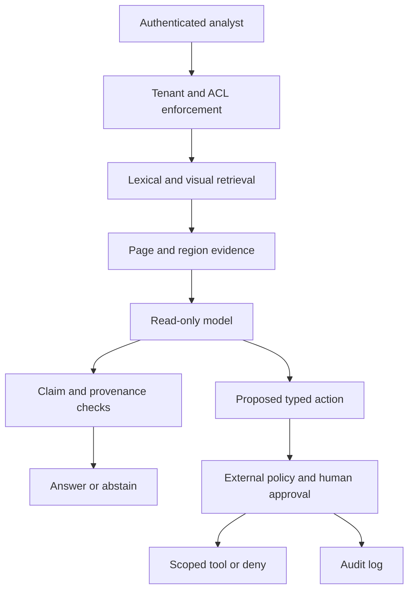

# Morning PhD lesson — Thursday 26 November 2026 (Asia/Kolkata)
## Multimodal retrieval, document intelligence and security failures in generative AI
**Provisional syllabus alignment:** Both course README files on main were read: [Generative AI](../../../advanced-generative-ai/README.md) and [Cybersecurity](../../../ai-for-cybersecurity/README.md). They contain directory descriptions, not session outlines. The complete recursive main tree did not expose standalone syllabus files. Root README.md, syllabus/README.md and syllabus/{Advanced_Generative_AI_and_Foundation_Models_Learning_Pathway,AI_for_Cybersecurity_Learning_Pathway}.md returned GitHub 404. No Gmail accessed. Continuity is the [23 Nov morning lesson](../2026-11-23/lesson.md), Unit 5 Session 4 in both courses, and the previously identified next topics (Unit 5 Session 5 in both). Dates 24–25 remain missing; this lesson covers the next uncompleted topic, not three sessions at once. Exact alignment remains pending.
 
## Spoken learning routes
10 minutes: why visual layout matters, MaxSim arithmetic, why relevance is not authority, and the five short recall questions. 30 minutes: add contrastive learning, region grounding, security boundaries, calibration and the worked incident. Extended 80–100 minutes: derive the loss, run the labs when stationary, discuss all questions, compare the four readings and design a preregistered experiment.

## Prerequisites and vocabulary
A document is a collection of pages; a page contains text, shapes, images and their spatial arrangement. OCR (optical character recognition) recovers text from pixels. A bounding box is a region (x0,y0,x1,y1) often normalized by page width and height. Reading order is the sequence in which regions should be interpreted. An embedding is a learned vector; cosine similarity measures angle after normalization. Retrieval selects evidence candidates; grounding ties a claim to a specific evidence span; authorization determines whether a principal may read or act on a resource. Confabulation means fluent unsupported or incorrect output. Prompt injection is an attempt to make untrusted content influence instructions. An abstention declines to make an unsupported claim. Recall@k measures coverage of relevant items among the first k retrieved. Precision@k measures their fraction. A SOC is a security operations center.

## A. Document intelligence
### A1. Why flattening a document loses meaning
Imagine two table rows: Service A, 3 failures, limit 5; Service B, 7 failures, limit 9. An OCR stream ordered by columns might read A B 3 7 5 9. The words and digits are intact, but row relations are lost. A question about A must pair the correct cells, not the closest token. A diagram likewise encodes meaning in arrows and spatial relationships. A page image preserves these cues but small type, compression, handwriting or rotation can make it unreadable. OCR provides exact searchable strings when it works; visual embeddings provide layout-aware matching; neither guarantees correct extraction.

### A2. Three architectures and trade-offs
1. OCR-first: render pages, OCR, detect blocks/tables, reconstruct reading order, chunk with page coordinates, index lexical and dense vectors, retrieve, rerank, answer. Cheap exact matching for error codes, searchable and debuggable; OCR errors and complex layouts propagate.
2. Layout-aware model: combine token embeddings, positions and visual patches. A conceptual input h_i = E_token(w_i) + E_position(i) + E_box(b_i) + E_type(t_i); actual architectures differ. Attention links neighboring or distant cells. LayoutLMv3 [R2] uses unified text/image masking and word-patch alignment in pretraining; it supports document understanding, not a proof of truth.
3. Visual multi-vector retrieval: encode each page into contextual patch vectors and query into token vectors; use late interaction to match each query token to its strongest page region. ColPali [R1] is a representative method. OCR-free retrieval avoids a separate text extraction pipeline, but exact values and citation regions still need validation. Many vectors per page increase memory and search cost.

A hybrid system can combine ranked lists without pretending incompatible scores are calibrated probabilities. Reciprocal rank fusion: RRF(d) = sum over rankers r of 1/(c + rank_r(d)), c>0; absent items contribute zero. For c=60, page A at ranks 1 and 4 scores 1/61+1/64=.03202; page B at ranks 2 and 2 scores 2/62=.03226. B wins despite no first-place rank. Tune weights only on validation data. Exact identifiers often deserve a lexical branch; visual-only tables deserve a page branch.

### A3. Derive the late-interaction score
Let q_i be a unit query-token vector, p_j a unit page-patch vector, d their dimension. The dot product q_i^T p_j = cos(theta) is in [-1,1], since ||q_i-p_j||^2 = 2-2 q_i^T p_j. A useful score S(Q,P)=sum_i max_j q_i^T p_j. Each query token finds its best patch; the sum rewards coverage. It is not a normalized likelihood, and a patch can win for multiple tokens. For Q=[(1,0),(0,1)], page A patches [(1,0),(0,1)] gives 1+1=2. Page B patches [(0.8,0.6)] gives .8+.6=1.4. A ranks first. This does NOT show A contains the requested row: patches can lie in different rows. Add region/row constraints at the verification stage rather than treating score as proof. Naive scoring costs O(mnd) per page with m query tokens, n patches; page index storage for N pages with float32 is 4Nnd bytes (e.g. N=10000,n=512,d=128 gives 2.62 GB decimal, excluding overhead). Compression, candidate pruning and approximate nearest neighbor search trade recall for resources.

### A4. Training intuition and derivation
For one query with one labeled positive page and B-1 negatives, let s_j be similarity and temperature tau>0. Define p_j=exp(s_j/tau)/sum_l exp(s_l/tau); cross-entropy L=-log p_positive = log(sum_l exp(s_l/tau))-s_positive/tau. Differentiate: dL/ds_j=(p_j-1[j=positive])/tau. Gradient descent raises the positive score and lowers negatives; low tau emphasizes difficult negatives but can amplify noisy labels. Example scores 2 and 1 with tau=1 yield p_positive=1/(1+exp(-1))=.7311, loss=.3133. Gradients -.2689 and +.2689. This is a generic contrastive objective, not a claim about the exact loss of every cited model. False negatives (two valid pages) make the objective punish useful retrieval; multi-positive labels and careful hard-negative mining help.

### A5. Evaluation and grounding
Given relevant pages {A,C}, retrieved [A,B,D], recall@3=1/2, precision@3=1/3, reciprocal rank=1. For evidence claims define citation precision = supported cited claims / cited claims; citation coverage = supported cited claims / all factual claims. Neither metric alone captures whether the user request was answered. For box overlap use IoU=area(intersection)/area(union). Boxes [0,0,2,2] and [1,1,3,3] overlap area 1, union 7, IoU=1/7. A correct page with the wrong cell can fail region grounding. Use page, region, table row/column, source revision and exact quote/value in evidence records. Distinguish source authenticity from support: even a forged document can support a claim about what it says.

## B. Security failures in generative AI
### B1. Trust boundaries
An LLM predicts useful outputs from context; retrieved evidence is not privileged instruction. The threat model includes an untrusted document publisher, a legitimate analyst, a retrieval service, model and separately authorized tools. Assets: private incident data, tenant boundaries, integrity of conclusions, execution permissions and audit records. Assume a document can contain misleading text or imagery, model errors are possible, and a user can lack permission. Do not execute actions or expose secrets based on retrieved content. Greshake et al. [R3] demonstrate indirect prompt injection in integrated applications; NIST [R4] supplies risk-management guidance.

Failure classes: (1) direct/indirect instruction confusion, (2) unsupported assertions or misread cells, (3) data leakage from retrieval or output, (4) poisoning and outdated evidence, (5) unsafe tool use and excessive privileges, (6) distribution shift and degraded OCR, (7) overreliance and automation bias. A filter that recognizes suspicious words cannot solve the trust-boundary problem: ordinary text may be harmful in context, and legitimate evidence may mention attacks. Treat all retrieved documents as data; constrain actions with a deterministic external authorization gate.

### B2. Reference architecture

Enforce ACLs before retrieval and again when resolving evidence IDs. Do not give the model credentials. Typed schemas constrain shape, not authority. A tool gateway validates principal, tenant, action, resource, scope, expiry and approval, denies by default and logs decision without leaking secrets. A read-only tutor never needs a write tool. A human approval UI must display the exact resource and effect, not an ambiguous model summary. Preserve immutable source hashes and timestamps; hashes demonstrate integrity relative to a known digest, not authenticity by themselves.

### B3. Decision theory and calibrated abstention
Let p be calibrated probability that a proposed claim is correct given evidence. Wrong answer loss Cw, abstention loss Ca, correct answer loss 0. Expected answer loss=(1-p)Cw; abstain if Ca < (1-p)Cw. Answer when p >= 1-Ca/Cw. With Cw=20 and Ca=2, threshold=.9. At p=.85 expected loss=3, abstain; at .95 expected loss=1, answer. This assumes calibration and fixed losses; raw similarity and model confidence are not calibrated p. For high-impact actions, authorization is a hard constraint independent of expected utility. Brier score for binary labels y and probabilities p is mean((p-y)^2). Reliability diagrams group probabilities and compare predicted with empirical correctness. Evaluate selective risk (wrong answered / answered) and coverage (answered / all), with confidence intervals and distribution shift checks.

### B4. Worked SOC case (synthetic)
An analyst asks whether service A exceeded the threshold in an incident screenshot. The page includes the A and B table above and a footer containing irrelevant instructions. Page retrieval correctly finds it, but a flattened reader pairs A with B's count. A region-aware extractor gets A=3 and limit=5; comparison 3>5 is false. The system cites page 2 row A, checks the screenshot time against the incident interval, labels the source a screenshot rather than authenticated live telemetry, and answers that the document does not show threshold exceedance. If OCR reads 3 as 8 or provenance is unavailable, abstain or seek a verified log. Any proposed change to production is denied by the read-only role. This separates retrieval success, extraction correctness, reasoning, evidence authenticity and authority.

Real research context: ColPali evaluates page retrieval [R1], LayoutLMv3 examines document understanding [R2], and Greshake et al. examine indirect injection in integrated applications [R3]. These are distinct empirical tasks; none proves the entire architecture secure. NIST guidance [R4] encourages lifecycle risk assessment, evaluation and monitoring; it is not a performance guarantee.

## C. Runnable Python labs (Python 3 standard library, synthetic only)
### Lab 1: late interaction and rank fusion
```python
from math import isclose
Q = [(1.,0.), (0.,1.)]
pages = {"A": [(1.,0.),(0.,1.)], "B": [(.8,.6)]}
def dot(a,b):
    return sum(x*y for x,y in zip(a,b))
def maxsim(q,p):
    return sum(max(dot(a,b) for b in p) for a in q)
scores = {k: maxsim(Q,v) for k,v in pages.items()}
assert isclose(scores["A"],2.) and isclose(scores["B"],1.4)
print(scores)
def rrf(ranks,c=60):
    return sum(1/(c+r) for r in ranks)
assert rrf([2,2]) > rrf([1,4])
print("fusion winner: B")
```
Expected: {'A': 2.0, 'B': 1.4}; fusion winner: B. All vectors are unit length and hand constructed, not trained embeddings. Extend by adding a page whose patches match query tokens in unrelated rows; show why higher score does not imply correct cell association. Real evaluation needs labeled relevance and region annotations.

### Lab 2: evidence verification and external authorization
```python
rows = {"A": (3,5), "B": (7,9)}
def claim(service, evidence_service):
    if service != evidence_service or service not in rows:
        return "ABSTAIN"
    count, limit = rows[service]
    return count > limit
def authorize(principal, tenant, resource_tenant, action):
    return (principal == "analyst" and tenant == resource_tenant
            and action == "read")
assert claim("A","A") is False
assert claim("A","B") == "ABSTAIN"
assert authorize("analyst","T1","T1","read")
assert not authorize("analyst","T1","T2","read")
assert not authorize("analyst","T1","T1","write")
print("grounded comparison: False; cross-tenant and write denied")
```
Expected one line as printed. This toy gate assumes trusted identity and metadata, and is not production authentication or a complete policy engine. Expand with stale timestamps, missing cells, multiple legitimate roles and explicit allowlist tests. Do not use live systems or private incident data. Code assertions are included; actual Python runtime execution was not performed during authoring.

## D. Misconceptions, ethics and research
- High recall does not imply accurate extraction; correct citation does not imply true source; correct answer does not imply permission to act.
- Multimodal retrieval is not inherently safer than OCR. Images are untrusted data too.
- Reducing attack success by refusing every request is not useful security. Track legitimate task success and false refusals.
- Store only needed evidence; redact identifiers where lawful, separate tenants, define retention, preserve chain of custody, document access, avoid surveillance overreach and test diverse layouts/languages. Do not publish customer incident artifacts.

Research question: Does region-constrained evidence verification improve supported-answer accuracy and reduce unsafe proposed actions without materially reducing useful task completion? Hypothesis: at equal retrieval budget, hybrid retrieval plus region verification reduces unsupported claims versus page-only verification. Factorial design: OCR vs visual vs hybrid retrieval, with/without region verifier; external authorization identical in all arms. Use licensed public documents and synthetic incident tables, split by document template and organization, avoid training/evaluation overlap. Annotate relevant pages, region IDs, exact claims and allowed actions with two reviewers and adjudication. Measure recall@k, region IoU, answer accuracy, citation precision/coverage, unsafe proposal rate, policy-denied action rate, legitimate completion, latency and memory. Report denominators, bootstrap CIs by document, stratify by scan quality and language. Preregister a minimum meaningful improvement and acceptable utility loss before evaluation. Falsification: no improvement with CI excluding the target benefit, or unacceptable latency/utility cost. Do not infer real incident prevalence from synthetic cases. A second question is whether uncertainty calibrated on clean documents transfers to noisy or unfamiliar templates; compare Brier score and risk-coverage curves on held-out domains.

## E. Progressive oral questions and answers
1. Why does OCR text lose meaning? Spatial relations can encode row or arrow structure. Follow-up: give a table counterexample.
2. What is a page embedding? A learned representation for similarity, not a factual assertion. Follow-up: why multiple vectors?
3. Explain MaxSim. Match each query vector to its strongest page vector, then sum. Follow-up: can the same patch win twice? Yes.
4. Why use hybrid retrieval? Exact strings and layout cues complement one another. Follow-up: what cost increases?
5. What is the contrastive gradient? (p_j-y_j)/tau; positive similarity rises under descent. Follow-up: why false negatives matter?
6. What does recall@3=0.5 mean? Half of labeled relevant pages appear in top three. Follow-up: does it prove correct extraction? No.
7. Why cite a region? It identifies evidence precisely. Follow-up: what if the region is authentic but outdated?
8. What is indirect prompt injection? Untrusted retrieved data influences model behavior as instructions. Follow-up: distinguish data from authority.
9. Why is JSON not a security boundary? It enforces shape, not permissions. Follow-up: who validates authorization?
10. What threshold follows Cw=20 and Ca=2? .9 under stated assumptions. Follow-up: why not use cosine score as p?
11. Can correct output still cause harm? Yes, disclosure or unauthorized action may violate policy. Follow-up: give a read-only example.
12. How would you falsify the research hypothesis? Compare preregistered benefit and utility trade-offs on held-out data. Follow-up: why split by template?
13. What is selective risk? Errors among answered cases. Follow-up: why report coverage alongside it?
14. What does a source hash establish? Equality to known bytes, not independent truth. Follow-up: what authenticates the source?
15. Explain the SOC example without notes. Correct page, correct row, count 3 below 5, cite and check timestamp, deny unauthorized writes.
16. What is the central lesson? Retrieval relevance, factual grounding and execution authority are separate guarantees.

## Source map
A1–A2 document layouts: R2; visual retrieval: R1. A3–A4 mathematical illustrations derive directly from definitions; no empirical effect sizes claimed. A5 metric definitions and examples are local derivations. B1 indirect injection: R3; risk categories and management: R4. B2–B4 architecture, decision derivation and case are original teaching examples, not certified deployments. C–E are original synthetic exercises and research proposals. See [references/index.md](references/index.md) for canonical links and access notes. No unverified current-news claim, no Gmail, audio or narration.
